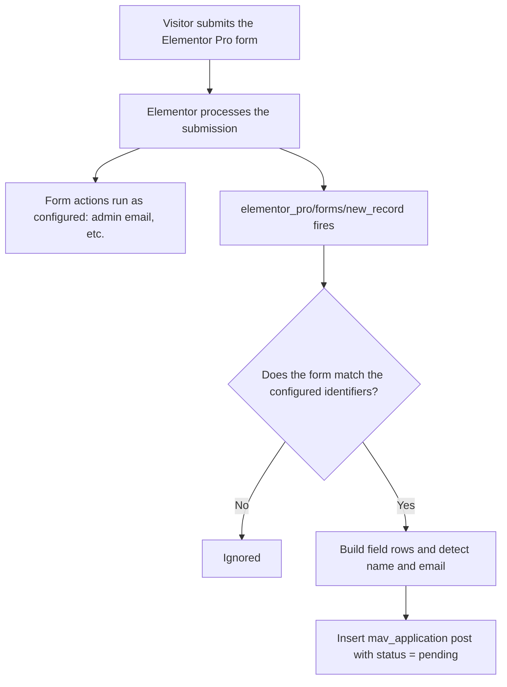

<div align="center">

# Application Vetting for Elementor

**Turn any Elementor Pro form into an application review queue.**


</div>

---

## What this is

A WordPress plugin that adds a review workflow to forms built with Elementor Pro.

When someone submits a form you have pointed the plugin at, it saves the full submission as a private record with a **Pending** status. A page on the front end of your site, visible only to logged-in administrators, lists those records as cards. An admin opens a card, reads everything the applicant submitted, and chooses **Approve** or **Reject**. Either choice opens an email composer. When the admin hits send, the email goes to the applicant and the application moves out of the Pending list.

It is not tied to any one site or industry. Anything that works as "someone applies, someone reviews, someone replies" fits: job applications, membership requests, vendor or partner onboarding, speaker submissions, scholarship or grant applications, directory listings. The only requirements on the form are an applicant name and an email field, and even the field IDs for those are configurable.

## Why it exists

Elementor Pro forms are good at collecting data and emailing it to someone. They stop there. For an application process that means:

- Submissions live as emails in an inbox, with no shared list of what is still waiting.
- There is no status. Whether an application was answered is tracked by memory or by a spreadsheet.
- The reply to the applicant is written in a separate mail client, so the site has no record of what was decided or what was said.
- The form's field data is flattened into an email body and is hard to look back through.

This plugin adds the missing middle: a stored record, a status, a review screen, and a decision step that saves the status and sends the email in one action. It sits beside Elementor's own form actions and does not replace them, so the form's existing admin notification keeps working.

## What it does

| Area | Behavior |
| --- | --- |
| Capture | Listens to Elementor Pro form submissions and stores every field, however the form is built |
| Status | Each application is `pending`, `approved` or `rejected`, stored with who decided and when |
| Dashboard | A shortcode renders a card grid with name, email and submission date, plus Pending, Approved and Rejected tabs |
| Review | Clicking a card opens a slide-out panel showing all submitted data |
| Decision | Approve and Reject each open a composer with a locked recipient, an editable subject and a rich-text body |
| Email | Sends HTML mail with a plain-text alternative through `wp_mail()`, and saves the sent subject and body |
| Access | Administrators only. Everyone else is redirected to the WordPress login page |
| Branding | Four colors exposed as CSS variables and as settings. Typography is inherited from the theme |

## How it works

### 1. Capturing a submission



The plugin hooks `elementor_pro/forms/new_record` at priority 20. The callback only reads from the record. It never modifies it, never adds a form error and never stops execution, and the whole handler is wrapped in `try/catch`. If something fails inside the plugin, the form still submits and Elementor's own actions still run.

**Matching the form.** A submission is stored if its Form Name, CSS ID, widget ID or `form_id` matches one of the comma-separated identifiers in the plugin settings. An empty setting matches every Elementor form. There is also a debug option that logs the identifiers of ignored forms, since the identifier Elementor exposes is not always the one people expect.

**Reading the fields.** The plugin walks `$record->get('fields')` and keeps the id, label, type and value of each field. It skips fields that are not applicant data: reCAPTCHA, hCaptcha, Turnstile, honeypot, step, HTML and password fields. Array values, such as multi-select checkboxes, are joined into a string. Every value goes through `sanitize_textarea_field()`, which strips tags and keeps line breaks. Because the fields are stored as a list rather than as fixed columns, the plugin does not care what the form asks.

**Finding the name and email.** Since the form's field IDs are not known in advance, identity detection works in layers:

1. Field IDs set in the plugin settings, if any.
2. Auto-detection on normalized IDs and labels, so `first_name`, `First Name` and `fname` all resolve to a first name.
3. For email, the first email-type field whose ID or label does not contain `confirm`, `verify`, `repeat` or `retype`. This matters for forms with a "Confirm Email" field.
4. Fallbacks: a full-name field, then the part of the email before the `@`, then "Unnamed applicant".

If no valid email is found, the application is still saved so nothing is lost. The dashboard then disables Approve and Reject for that record and says why.

### 2. Data model

Applications are a custom post type, `mav_application`. WordPress limits post type keys to 20 characters, which is why the slug is short.

The post type is private: not public, not queryable, not in search, no REST endpoint, no rewrite rules. Every capability is mapped to `manage_options`, and creating posts from wp-admin is disabled, so records only come from form submissions. The wp-admin list view and a read-only details box exist for auditing.

| Meta key | Contents |
| --- | --- |
| `_mav_status` | `pending`, `approved` or `rejected` |
| `_mav_name`, `_mav_first_name`, `_mav_last_name` | Detected applicant name |
| `_mav_email` | Applicant email, the only address decision emails are sent to |
| `_mav_form` | Identifier of the form that produced the record |
| `_mav_fields` | Array of `id`, `label`, `type`, `value` for every submitted field |
| `_mav_decided_at`, `_mav_decided_by` | Timestamp and user ID of the deciding administrator |
| `_mav_email_subject`, `_mav_email_body` | The email that was sent |

Status is stored in meta rather than as a post status. That keeps every record `publish` internally, avoids custom post status registration, and makes the per-status queries a plain meta match.

WordPress unslashes data in `update_post_meta()`, so values are passed through `wp_slash()` first. Without that, backslashes in an applicant's text would be silently lost.

### 3. Access control

The dashboard is a shortcode, `[application_vetting_dashboard]`, and access is checked in three places:

- **`template_redirect`:** before any output, the plugin checks whether the current page contains the shortcode, in `post_content` or in Elementor's `_elementor_data` meta, and redirects anyone who is not an administrator. The same hook sends no-cache headers, defines `DONOTCACHEPAGE` and adds `noindex`.
- **The shortcode itself:** a fallback for shortcodes the first check cannot see, such as ones placed in theme templates. It redirects if headers are still unsent, and falls back to a JavaScript redirect if not.
- **Every AJAX endpoint:** each request checks the capability and a nonce, independent of the page.

A visitor who is not logged in goes to the login page and returns to the dashboard afterwards. A logged-in non-admin is sent to the login form with `reauth=1`. Without it, `wp-login.php` would redirect the logged-in user straight back to the dashboard and loop. The capability is filterable through `mav_required_capability`.

### 4. The AJAX API

The front end talks to three `admin-ajax.php` actions, all registered under `wp_ajax_` only, so they are never available to logged-out users.

| Action | Purpose |
| --- | --- |
| `mav_list` | Returns a page of 12 applications for one status, whether more pages exist, and the count for every status |
| `mav_get` | Returns one application's fields, decision details if any, and the personalized starter text for both emails |
| `mav_decide` | Sends the email and records the decision |

The AJAX URL is passed to the script as a root-relative path, so requests keep working if the site is opened under both its `www` and non-`www` hostnames.

### 5. What happens when you press Send

`mav_decide` is where the plugin changes state, so it is deliberately strict:

1. Verify capability and nonce.
2. Validate the decision (`approved` or `rejected`), a non-empty subject and a body with actual text in it.
3. Load the application and confirm it is still `pending`. A second click or a second admin gets a clear error instead of a duplicate email.
4. Read the recipient from `_mav_email`. The request has no way to set it.
5. Take a short transient lock on the record to block simultaneous submissions.
6. Send the email.
7. **Only if sending succeeds**, write the new status, timestamp, user ID, subject and body. If sending fails, the application stays pending and the admin sees the mail error.
8. Fire `mav_application_decided` and return the updated counts.

The subject is passed through `sanitize_text_field()`, which removes line breaks and so closes off header injection. The body is passed through `wp_kses_post()`.

### 6. Email delivery

`MAV_Mailer` wraps `wp_mail()`:

- Sends HTML with a small table-based wrapper that works in common mail clients, and is filterable through `mav_email_html`.
- Builds a plain-text alternative from the body and attaches it as `AltBody` through `phpmailer_init`, which helps spam scoring.
- Adds optional `From`, `Reply-To` and `Bcc` headers. The Bcc is the sending admin, if they ticked "Send me a copy".
- Listens to `wp_mail_failed` for the duration of the call so the real error message can be shown, then removes its listeners.

Starter text for each email is configurable and supports `{first_name}`, `{last_name}`, `{full_name}` and `{site_name}`. In the body, applicant-supplied values are HTML-escaped on insertion.

### 7. The front end

`dashboard.js` is plain JavaScript with no dependencies and no build step.

- **Rendering:** every piece of text is inserted with `textContent` or DOM nodes. The only `innerHTML` use is the starter text of the email the admin is about to edit, which comes back from the server already sanitized and escaped.
- **Panel:** the slide-out and toast are moved to `<body>` on load, so theme containers with `transform` or `overflow` cannot clip or misplace them. The panel traps focus, closes on Escape, returns focus to the card that opened it and asks before discarding an unsent email.
- **Composer:** a `contenteditable` region with a small toolbar (bold, italic, underline, lists, link, clear formatting). Pasted content is inserted as plain text to keep stray markup out. An inline bar handles links so there is no `prompt()` dialog.
- **Linkification:** URLs in submitted data, such as a website or uploaded file links, become links, limited to `http` and `https`.

### 8. Styling

All colors come from CSS custom properties on `.mav-root`: `--mav-primary`, `--mav-burgundy`, `--mav-teal` and `--mav-orange`. The lighter tints are derived from those with `color-mix()`, behind an `@supports` check with fixed fallbacks, so changing four hex values re-themes everything. Colors are also editable from the settings page, which outputs the overrides as inline CSS.

Status is color-coded consistently: orange for pending, teal for approved, burgundy for rejected. Typography is inherited from the active theme, and every button restates its own properties so aggressive theme or Elementor kit button styles do not bleed in. Motion respects `prefers-reduced-motion`.

## Security notes

- Administrator capability and a nonce are required on every AJAX request.
- The recipient address is never accepted from the client.
- Applicant input is sanitized on the way in and escaped or inserted as text on the way out.
- The dashboard page is sent with no-cache headers and `noindex`.
- Applications contain personal information, so the post type is not exposed to REST, search or any public query. Stored data is only deleted on uninstall if that option is explicitly turned on.

## Tech stack

| Layer | Used |
| --- | --- |
| Platform | WordPress 6.0+, PHP 7.4+ |
| Form source | Elementor Pro Forms (`elementor_pro/forms/new_record`) |
| Storage | Custom post type and post meta |
| Server API | `admin-ajax.php`, `WP_Query`, WordPress Settings API |
| Mail | `wp_mail()` and PHPMailer through WordPress |
| Frontend | Vanilla JavaScript, CSS custom properties |

## Project structure

```
plugin-root/
├── <main plugin file>.php           Plugin header, constants, includes
├── uninstall.php                    Opt-in data removal
├── includes/
│   ├── class-mav-plugin.php         Bootstrap and activation
│   ├── class-mav-capture.php        Elementor Pro form hook
│   ├── class-mav-post-type.php      Post type, admin columns, details box
│   ├── class-mav-helpers.php        Options, identity detection, placeholders
│   ├── class-mav-dashboard.php      Shortcode, access guard, assets
│   ├── class-mav-ajax.php           list, get and decide endpoints
│   ├── class-mav-mailer.php         wp_mail wrapper
│   └── class-mav-settings.php       Settings page
├── templates/
│   └── dashboard.php                Dashboard markup
└── assets/
    ├── css/dashboard.css
    └── js/dashboard.js
```

## Extension points

| Hook | Type | Use |
| --- | --- | --- |
| `mav_application_captured` | action | Runs after an application is stored. Receives the post ID, field rows and detected identity |
| `mav_application_decided` | action | Runs after the email is sent and the status saved. Receives the post ID, decision, subject and body |
| `mav_email_html` | filter | Replace the HTML wrapper around the email body |
| `mav_required_capability` | filter | Change the capability required to use the dashboard (default `manage_options`) |

## Design decisions and trade-offs

- **`contenteditable` instead of `wp_editor()`.** TinyMCE does not initialize reliably inside containers that start hidden, which is how a slide-out panel starts. The cost is that the editor relies on `document.execCommand`, which is deprecated but still supported in every major browser. If that changes, the editor is a small, self-contained piece to replace.
- **`admin-ajax.php` instead of the REST API.** The dashboard is admin-only and low traffic, and `admin-ajax.php` keeps the endpoints private by default with no route registration. REST would be a reasonable migration if the plugin grows.
- **Status in meta.** Simpler queries and no custom post status registration, at the cost of the wp-admin status filters WordPress provides for real post statuses.
- **Capture is best-effort.** A failure in the plugin is logged and swallowed. Losing a record is a smaller problem than breaking a public form.
- **Elementor Pro only.** The capture hook belongs to Elementor Pro's Form widget. Supporting other form plugins would mean adding a second capture class that feeds the same storage layer.

## Contributing

Issues and pull requests are welcome.

- **Open an issue first** for anything beyond a small fix, so the approach can be agreed before code is written.
- **Keep pull requests to one concern.** A bug fix and a refactor should be separate.
- **Follow the [WordPress Coding Standards](https://developer.wordpress.org/coding-standards/wordpress-coding-standards/).** The existing code uses tabs, Yoda conditions and `phpcs:ignore` comments where a rule is deliberately bypassed. Say why when you add one.
- **Keep the prefixes.** PHP classes use `MAV_`, hooks, options and meta use `mav_` or `_mav_`, and CSS classes use `mav-`, so nothing collides with the theme or other plugins.
- **Escape late, sanitize early.** Any new output goes through the matching `esc_*` function, and any new input is sanitized and capability-checked. Anything that changes state also needs a nonce.
- **Keep the front end dependency-free.** No build step and no third-party scripts or CDNs.
- **Test against a real Elementor Pro form.** Describe what you tested in the pull request: the form fields used, the WordPress and PHP versions, and whether Elementor's own email still arrived.
- **Never include real applicant data** in issues, screenshots or test fixtures.
- **Report security problems privately** through GitHub's private vulnerability reporting rather than a public issue.

## License

GPL-2.0-or-later, as declared in the plugin header.